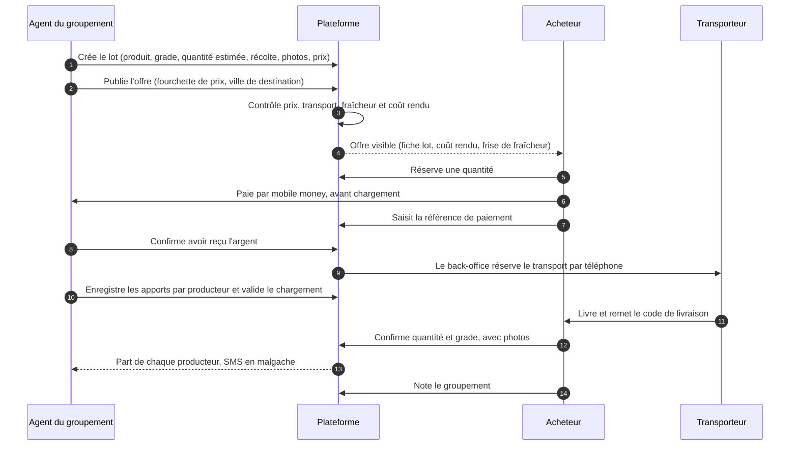
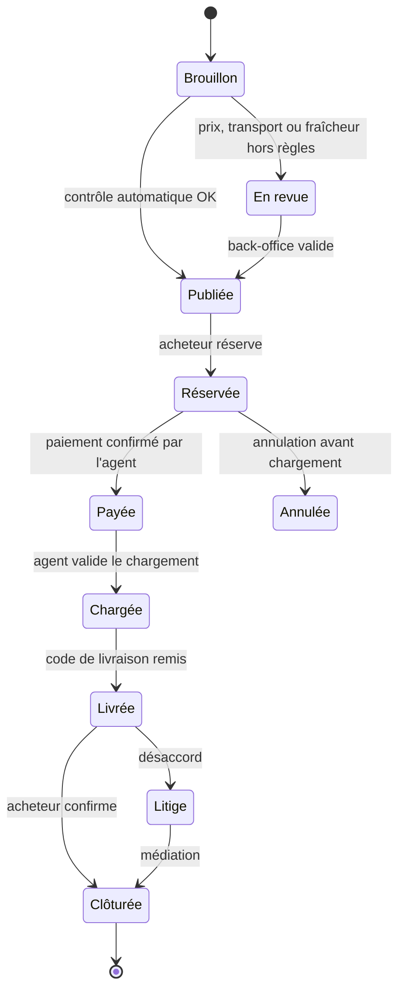

# Flux et écrans du MVP

Entrée du futur processus de design (design system, maquettes). Les écrans ne sont **pas** validés : seuls les flux, les états et le contenu fonctionnel le sont. Vocabulaire : [GLOSSARY.md](../GLOSSARY.md).

## Parcours de bout en bout

## États d'une commande

L'annulation par l'acheteur est gratuite avant le chargement. Après, c'est un défaut noté.

## Champs d'un lot

À la création : produit et variété, grade (photos de référence), quantité estimée, date de récolte, disponibilité, point de collecte, fourchette de prix, villes de livraison, au moins 2 photos. Optionnel : séchage ou humidité, pratiques de culture. Les apports par producteur sont saisis au chargement.

Ajouté par la plateforme : score de fiabilité, nombre et volume de commandes livrées, ancienneté, avis des acheteurs, lots précédents, groupement vérifié.

## Règles de calcul

- **Coût rendu au kilo** = prix producteur + (nombre de sacs × tarif de transport par sac) / quantité.
- Avertissement si le coût rendu dépasse le prix de référence de la ville d'arrivée ; pas de blocage.
- Lot en revue si le transport dépasse un seuil (proposé : 25 à 30 % du coût rendu) ou si la fraîcheur restante est inférieure à 50 %.
- **Fraîcheur restante** = (durée de conservation − jours de préparation − jours de transport) / durée de conservation.
- Exemple de l'énoncé : 10 000 Ar de transport pour un sac de 20 kg font 500 Ar/kg.

## Inventaire des écrans

**Agent (PWA mobile, hors-ligne, malgache par défaut)** : A1 Connexion · A2 Accueil · A3 Nouveau lot en 3 étapes · A4 Détail d'une commande · A5 Répartition par producteur · A6 Calendrier de récolte · A7 Prix du marché.

**Acheteur (web, français)** : B1 Inscription et validation · B2 Catalogue des offres · B3 Détail d'un lot · B4 Réservation et paiement · B5 Mes commandes · B6 Récoltes à venir.

**Back-office (web desktop)** : C1 Validation des comptes · C2 File de revue · C3 Commandes et paiements · C4 Transporteurs · C5 Litiges · C6 Référentiels (produits, durées de conservation, prix de référence, villes, seuils) · C7 Indicateurs du pilote.

## Notifications

| Événement | Destinataire | Canal | Langue |
| --- | --- | --- | --- |
| Lot mis en revue | Agent | Application | Malgache |
| Lot publié | Acheteurs abonnés | Application, e-mail | Français |
| Offre réservée | Agent | SMS, application | Malgache |
| Référence de paiement saisie | Agent | SMS, application | Malgache |
| Paiement confirmé | Acheteur, back-office | Application, e-mail | Français |
| Transport réservé | Agent, acheteur | Application | Malgache, français |
| Chargement validé | Acheteur | Application, e-mail | Français |
| Code de livraison | Transporteur | SMS | Malgache |
| Livraison confirmée | Agent, back-office | Application | Malgache |
| Part de chaque producteur | Producteurs | SMS | Malgache |
| Litige ouvert | Back-office, agent, acheteur | Application | Malgache, français |

Les acheteurs reçoivent aussi des messages par WhatsApp et Messenger ; le SMS leur est réservé dans un abonnement spécial.

## Décisions de conception

- Création d'un lot en 3 étapes ; apports par producteur saisis au chargement.
- Prix fixe dans la fourchette, pas de négociation.
- Une commande porte sur un seul lot d'un seul groupement.
- Paddy et riz blanc sont deux produits distincts.
